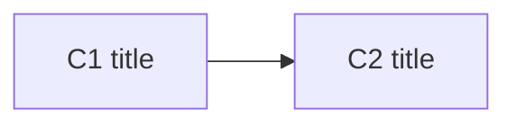

# Plan, <epic title>

**Slug:** `<epic-slug>`
**Base branch:** `<branch>` → integration branch `epic/<slug>`
**Concurrency:** <n> agents
**Isolation:** git worktrees / shared tree
**Rules:** `rules.md` (CLAUDE.md + <n> extras)

## Acceptance criteria (from the description)
- AC1: ...
- AC2: ...

## Out of scope
- ...

## Chunks

### C1, <title>  [size S/M/L]  wave 1
**Goal:** ...
**Acceptance:** AC1 (partial), AC3
**Owns:** `src/foo/`, `tests/foo/`
**Exposes:** K1, K2
**Consumes:** , 
**Depends on:** , 

### C2, <title>  [size]  wave 2
...

## Dependency graph

## Waves
| Wave | Chunks | Unblocks |
|---|---|---|
| 1 | C1 | C2, C3 |
| 2 | C2, C3 | C4 |

## Contracts (proposed, see contracts.md)
| ID | Exposed by | Consumed by | Shape |
|---|---|---|---|
| K1 | C1 | C2, C3 | `fn(...) -> ...` |

## Coverage check
Every AC → at least one chunk: ✓ / gaps: ...
Every chunk → at least one AC: ✓ / orphans: ...

## Open questions for the user
- ...
